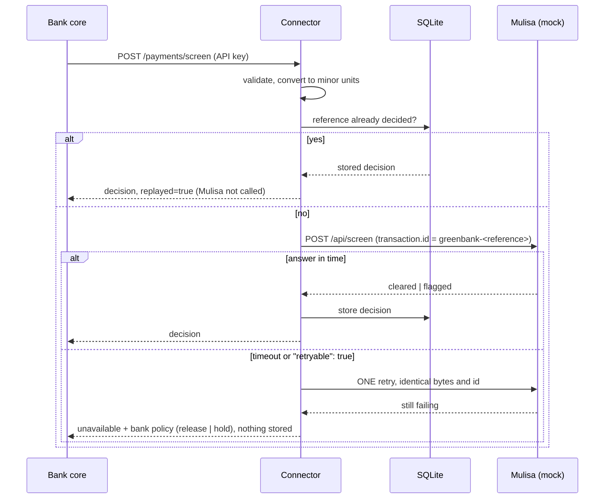

# Mulisa screening connector (jengacore Track C)

A small FastAPI service between greenbank's core banking system and Mulisa's screening API.
The core sends a payment in greenbank's own JSON format; the connector validates it, maps it to
Mulisa's `POST /api/screen` request, calls Mulisa safely (timeout, at most one retry, idempotency)
and returns a normalised decision: `cleared`, `flagged` or `unavailable`.



## Run it

```bash
python3 -m venv .venv && source .venv/bin/activate
pip install -r requirements-dev.txt
cp .env.example .env     # fill in: SCREENING_UNAVAILABLE_POLICY, CONNECTOR_API_KEYS, MULISA_API_KEY, MOCK_API_KEY
set -a; . ./.env; set +a # the MOCK reads real environment variables, not the .env file

python -m mock_mulisa.server &                       # local Mulisa mock on :9100
uvicorn app.main:create_app --factory --port 8000    # the connector
CONNECTOR_KEY=<your key> ./scripts/demo.sh           # every scenario from the brief
pytest                                               # 130+ tests
```

`MULISA_API_KEY` (connector) and `MOCK_API_KEY` (mock) must be the same value. The application
**refuses to start** if `SCREENING_UNAVAILABLE_POLICY` is missing, a key is short or still a
`CHANGE_ME` placeholder, or `MULISA_URL` is plain http to a non-local host.

## API

`POST /payments/screen`, header `X-Api-Key: <key>` (or `Authorization: Bearer <key>`).

```json
{ "reference": "GB-PAY-20261014-0042", "amount": "250000", "currency": "RWF",
  "debtor":   { "msisdn": "250788000111", "name": "Aline Uwase",  "wallet": "GB-0001" },
  "creditor": { "msisdn": "250722000333", "name": "Eric Mugisha", "provider": "bluemobile" },
  "createdAt": "2026-10-14T16:40:00Z" }
```

| decision | recommended_action | meaning |
|---|---|---|
| `cleared` | `release` | Mulisa cleared it |
| `flagged` | `hold` | Mulisa flagged it (advisory; the bank decides) |
| `unavailable` | per **bank policy** | no answer: `fail_open` = `release`, `fail_closed` = `hold`; `reason` and `policy_applied` say why |

Errors: `{"error": {"code", "message", "request_id", "details?"}}`, never a stack trace or an echoed value.
`400` bad JSON, `401` auth, `409` same reference with a different payment, `413` too large,
`422` invalid message (including amount precision, unknown currency, future date), `500` generic.
`GET /health` is the only public route (`/docs` is off unless `ENABLE_API_DOCS=true`).

## Layout

```
app/core/          config (refuses to start), errors, security (API keys), log, reference data
app/schemas/       pydantic: bank message in, Mulisa request/response, our response
app/models/        SQLAlchemy: one row per decision (no names, phones or wallets)
app/repositories/  the only code that talks to the database
app/services/      money (minor units), mapping, mulisa_client (timeout/retry), screening_service
app/routers/       HTTP only, no business logic
mock_mulisa/       local Mulisa stand-in: threshold + blacklist flagging, idempotent, slow/failing on demand
config/            reference-data.json: currency decimals and phone calling codes
data/              synthetic payments for the demo
tests/             unit/, api/, repositories/
```

Nothing business-specific is hard-coded: keys, URL, timeout, policy, institution id, id prefix,
transaction type, channel and clock skew are settings; currency decimals and calling codes are in
`config/reference-data.json`.

## Mapping assumptions (greenbank format to Mulisa `POST /api/screen`)

> The `ScreeningRequest` schema section of the public OpenAPI was cut off when I read it, so which
> fields are *required* is inferred from the contract's example request. Please check against the live contract.

| Mulisa field | Source | Assumption |
|---|---|---|
| `transaction.id` | `<TRANSACTION_ID_PREFIX or institution id>-<reference>` | Mulisa's id is an instance-wide idempotency key, so the bank id is prefixed to avoid collisions between banks. Identical on every retry |
| `transaction.reference` | `reference` | the bank's own reference, as sent |
| `transaction.amount` | `amount` | integer **minor units** via exact `Decimal` arithmetic (RWF 0 decimals, KES 2); never floats. Too many decimals, zero, or above 2^53-1 refused |
| `transaction.timestamp` | `createdAt` | converted to UTC; more than `MAX_FUTURE_SKEW_SECONDS` in the future refused |
| `transaction.type` / `channel` | settings | `transfer` / `api` (the bank message has neither) |
| `country_from` / `sender.country` | `BANK_COUNTRY` | the debtor is a bank customer |
| `country_to` / `receiver.country` | creditor phone calling code | longest prefix; unknown prefix means the field is **omitted**, not guessed |
| `sender.id`, `sender.account` | `debtor.wallet` | the ledger account that is debited |
| `sender.institution_id` | `BANK_INSTITUTION_ID` | greenbank has no BIC |
| `receiver.id`, `receiver.account` | `creditor.msisdn` | the only receiver identifier in the message |
| `receiver.institution_id` | `creditor.provider` | e.g. `bluemobile` |

Other decisions:
- **Retry rule:** one retry, only after a timeout or when Mulisa's error body says `retryable: true`. A 4xx, an unreadable answer, or nothing listening is **not** retried.
- **`unavailable` returns HTTP 200** with the policy action (the core needs it) and is **not stored**, so a re-submission after recovery is screened for real.
- An answer that is not exactly `cleared` or `flagged` is treated as `unavailable`, never as `cleared`.
- Idempotency: decisions are stored by reference (database UNIQUE key, so it holds across processes and restarts); a per-reference lock makes simultaneous duplicates share one Mulisa call. Same reference with a different payment returns `409`.

## Security note (three main risks)

1. **Personal data (names, phone numbers).** Never logged (log lines carry only request id, caller, reference, decision, timings), never echoed in errors (field and rule only), never stored (the table holds decisions only). Tests assert it. *Still to do:* TLS in front of the service.
2. **Wrong failure policy.** A silent default could release unscreened money. The policy is required with no default, the app will not start without it, and every `unavailable` response states which policy was applied. *Would add:* an alert on `screen_unavailable` log events.
3. **API key handling.** Keys only from the environment (`.env` is git-ignored), at least 16 characters, one per calling system, compared as SHA-256 digests in constant time against every key, 16 KB body limit, no redirects followed (cannot forward a key), plain http refused except localhost. *Not done:* key rotation, rate limiting.

Dependency audit: `pip-audit -r requirements.txt` reported **no known vulnerabilities** (run before submitting; rerun if versions change).

## Known limitations and next steps

- Authentication runs after the body is parsed, so an unauthenticated request with *broken JSON* gets `400` instead of `401` (valid JSON with a bad body correctly gets `401`). Low risk; fix by authenticating in middleware.
- The Mulisa timeout is the socket timeout of each read, not a total deadline; a server that trickles bytes could exceed it. A total deadline would need a worker thread or `httpx`.
- The per-reference lock is per process; across several processes the database UNIQUE key is the safety net.
- One global policy, as the brief asks. A per-amount policy would be the natural next step.
- SQLite and `create_all`; a real deployment would use Postgres and Alembic migrations.
- Not done: rate limiting, key rotation, metrics, the optional ISO 20022 / batch / load-test items.
